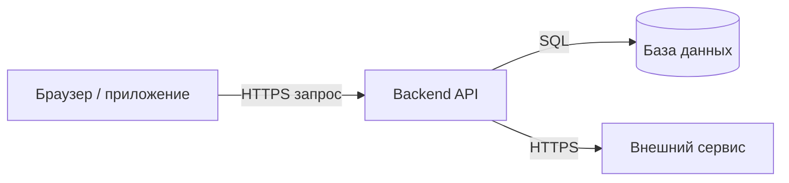

# Архитектура систем — уровень 1

## Клиент-сервер

**Клиент** инициирует взаимодействие, **сервер** принимает запрос, выполняет работу и возвращает ответ. Это роли относительно конкретного взаимодействия: backend — сервер для браузера и клиент для БД или платёжного API. Клиент и сервер могут работать как на разных машинах, так и на одной.

Пример заказа: браузер отправляет `POST /orders`; API проверяет аутентификацию, права и входные данные, выполняет бизнес-правила, сохраняет заказ в транзакции и отвечает. HTML/JavaScript-проверки клиента улучшают UX, но сервер обязан проверять всё повторно: клиент контролируется пользователем.

**Протокол** задаёт формат и правила обмена. **API** — доступные операции и контракты, включая ошибки. **Сеть** добавляет задержку и отказы: timeout означает, что клиент не дождался ответа, но не доказывает, что сервер не выполнил действие. Поэтому повтор создания заказа требует идемпотентности.

Три слоя не обязательно означают три сервера: presentation, application, data — логические обязанности. Одно приложение может включать несколько слоёв и работать в одном процессе; один серверный компонент может иметь много экземпляров за балансировщиком.

Преимущества: централизованные правила/данные, много разных клиентов, независимое обновление backend. Ограничения: зависимость от доступности сервера/сети, необходимость масштабирования, защиты и совместимости API. Резервирование убирает отдельные точки отказа только при корректной работе общей БД, маршрутизации и других зависимостей.

Вопросы для ответа вслух: кто клиент для БД? Где проверять доступ к чужому заказу? Почему timeout после `POST` нельзя автоматически считать отменой? Чем логический слой отличается от отдельного процесса?

Требования: [issue #13](https://github.com/Daetoya608/python_interview/issues/13). Семантика взаимодействия: [HTTP RFC 9110](https://www.rfc-editor.org/rfc/rfc9110.html).
