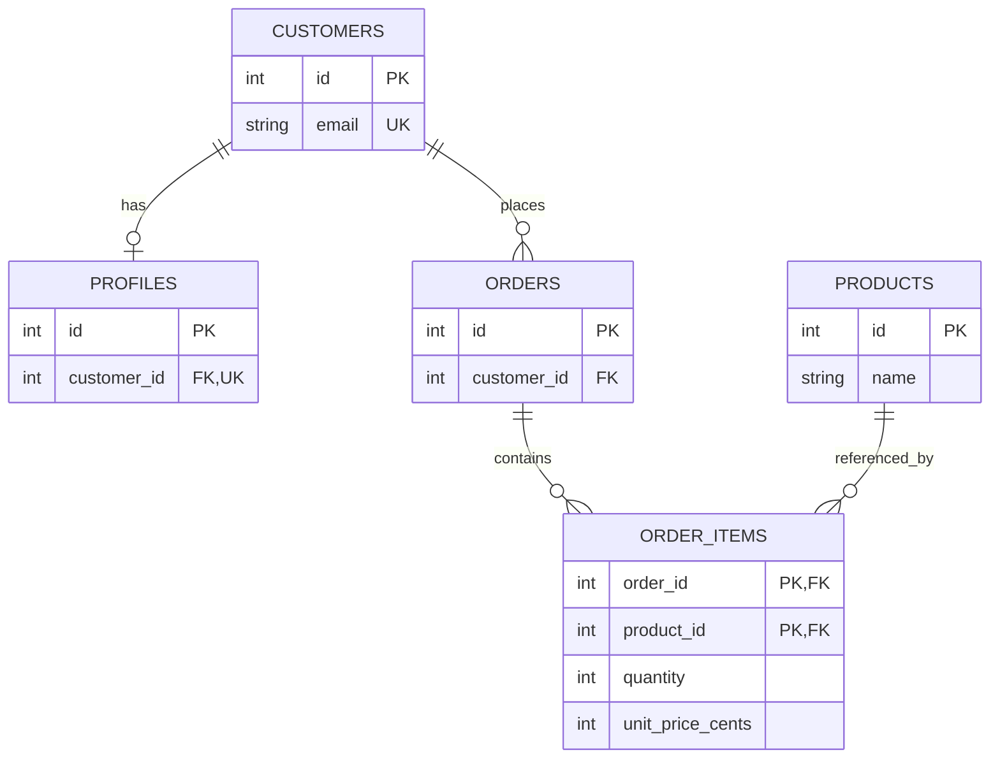

# Проектирование БД — уровень 2

Обязательно: связи, нормализация и доменная модель. Желательно: ERD.

## Сначала смысл данных

Перед таблицами ответьте: какие сущности существуют, что идентифицирует каждую, какие операции выполняются и какие правила нельзя нарушать. «Заказ» — не просто JSON из HTTP: у него есть владелец, позиции, состояние и история цены.

Проектирование: сценарии → сущности/идентичность → кардинальности → ограничения → запросы и индексы → жизненный цикл/миграции. Не каждая сущность обязана соответствовать одной таблице или одному микросервису.

## Связи

- **One-to-many:** orders.customer_id с FK на customers.id. Один клиент имеет несколько заказов.
- **One-to-one:** profiles.customer_id с FK, NOT NULL и UNIQUE. У клиента может быть ноль или один профиль; обязательность профиля для каждого клиента этим не обеспечивается.
- **Many-to-many:** отдельная таблица order_items с двумя FK и ключом пары. У связи могут быть свои атрибуты — количество, цена на момент покупки.

```sql
CREATE TABLE profiles (
    id INTEGER PRIMARY KEY,
    customer_id INTEGER NOT NULL UNIQUE REFERENCES customers(id),
    bio TEXT NOT NULL
);
CREATE TABLE order_items (
    order_id INTEGER NOT NULL REFERENCES orders(id),
    product_id INTEGER NOT NULL REFERENCES products(id),
    quantity INTEGER NOT NULL CHECK (quantity > 0),
    unit_price_cents INTEGER NOT NULL CHECK (unit_price_cents >= 0),
    PRIMARY KEY (order_id, product_id)
);
```

В этой модели товар встречается в заказе одной строкой. Если нужны разные варианты/партии одного товара отдельными строками, выбирают line_id/номер позиции и соответствующие ограничения, а не ломают это предположение неявно.

## Нормализация

Она уменьшает ненужное дублирование и аномалии вставки/обновления/удаления.

Пример плохой таблицы: order_id, customer_id, customer_email, product_1, product_2. Изменение email надо повторять, количество товаров ограничено колонками, удаление последнего заказа может потерять сведения о клиенте.

| Форма | Практический смысл |
|---|---|
| 1NF | Нет повторяющихся групп колонок; каждое поле содержит значение своего домена, а не список через запятую |
| 2NF | 1NF и нет зависимости неключевого атрибута только от части составного кандидатного ключа |
| 3NF | Устраняются нежелательные транзитивные зависимости неключевых данных от ключа через другие атрибуты |

Пример 2NF: в `(order_id, product_id)` имя товара зависит только от product_id — вынести в products. Количество относится к паре и остаётся в позиции.

Пример 3NF: `order_id → customer_id → customer_email`; актуальный email клиента хранится в customers, а в orders — ссылка. Для строгой проверки форм анализируют **все кандидатные ключи и функциональные зависимости**; популярные формулировки таблицы — объяснение для обычных учебных схем, не полное математическое определение.

Цена нормализации — дополнительные JOIN и необходимость аккуратных границ операций. Она не означает «разбить всё до единственной колонки в таблице».

**Цена покупки в order_items не обязана совпадать с текущей ценой products.** Это разные факты с разным временем жизни. Исторический адрес доставки тоже может быть самостоятельным снимком, а не ошибочной копией актуального адреса клиента.

## ERD



Диаграмма показывает ноль/несколько позиций; бизнес-правило «подтверждённый заказ не пуст» потребует отдельного обеспечения. ERD документирует модель, но не исполняет ограничения.

Самопроверка: какие данные зависят от части ключа? Что делать с исторической ценой? Почему uselist=False в ORM не создаёт one-to-one в БД? Может ли клиент не иметь профиля?

Источники: [Constraints](https://www.postgresql.org/docs/18/ddl-constraints.html), [основы нормализации](https://learn.microsoft.com/en-us/previous-versions/troubleshoot/microsoft-365/microsoft-365-apps/access/database-normalization-description).
