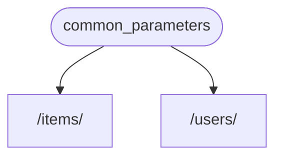
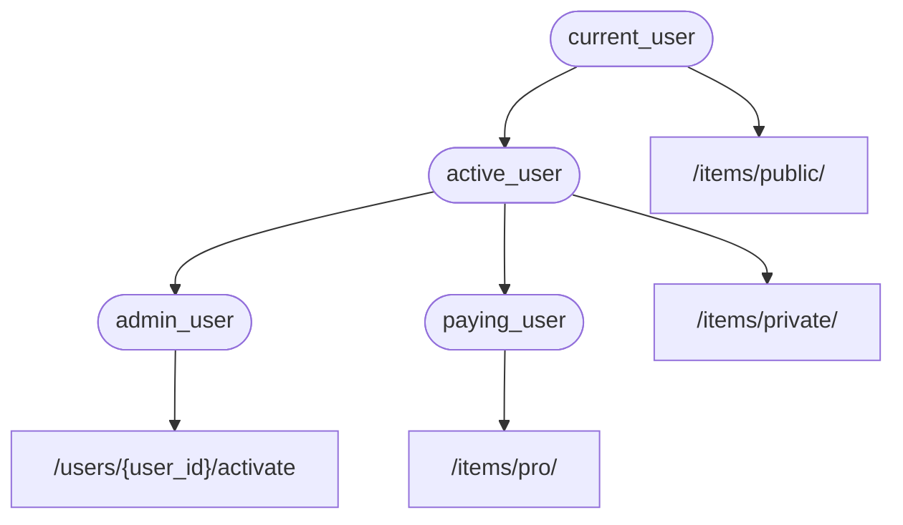

# Зависимости

> Перевод страницы [Dependencies](https://fastapi.tiangolo.com/tutorial/dependencies/) документации FastAPI.
> Оригинал: © Sebastián Ramírez, лицензия MIT.

В **FastAPI** есть очень мощная, но интуитивно понятная система **<dfn title="также известно как компоненты, ресурсы, провайдеры, сервисы, внедряемые объекты (injectables)">внедрения зависимостей</dfn>** (Dependency Injection).

Она спроектирована так, чтобы быть очень простой в использовании и чтобы любой разработчик мог очень легко интегрировать другие компоненты с **FastAPI**.

## Что такое «внедрение зависимостей»

**«Внедрение зависимостей»** в программировании означает, что у вашего кода (в данном случае — *функций операций пути*) есть способ объявить то, что ему нужно для работы: «зависимости».

А затем эта система (в данном случае **FastAPI**) берёт на себя всё необходимое, чтобы предоставить вашему коду эти зависимости («внедрить» их).

Это очень полезно, когда нужно:

* Иметь общую логику (один и тот же код снова и снова).
* Совместно использовать подключения к базе данных.
* Обеспечивать безопасность, аутентификацию, требования к ролям и т. д.
* И многое другое...

И всё это — с минимальным повторением кода.

## Первые шаги

Рассмотрим очень простой пример. Он будет настолько простым, что пока не очень полезным.

Зато так можно сосредоточиться на том, как работает система **внедрения зависимостей**.

### Создайте зависимость (dependable)

Сначала сосредоточимся на самой зависимости.

Это просто функция, которая может принимать все те же параметры, что и *функция операции пути*:

```python title="dependencies/tutorial001_an_py310.py"
from typing import Annotated

from fastapi import Depends, FastAPI

app = FastAPI()


async def common_parameters(q: str | None = None, skip: int = 0, limit: int = 100):
    return {"q": q, "skip": skip, "limit": limit}


@app.get("/items/")
async def read_items(commons: Annotated[dict, Depends(common_parameters)]):
    return commons


@app.get("/users/")
async def read_users(commons: Annotated[dict, Depends(common_parameters)]):
    return commons
```

Вот и всё.

**2 строки**.

И у неё та же форма и структура, что и у всех ваших *функций операций пути*.

Можно считать её *функцией операции пути* без «декоратора» (без `@app.get("/some-path")`).

И она может возвращать всё что угодно.

В данном случае эта зависимость ожидает:

* Необязательный параметр запроса `q` типа `str`.
* Необязательный параметр запроса `skip` типа `int`, по умолчанию `0`.
* Необязательный параметр запроса `limit` типа `int`, по умолчанию `100`.

А затем просто возвращает `dict` с этими значениями.

> **Примечание**
>
> Поддержка `Annotated` появилась в FastAPI (и он начал рекомендовать её) в версии 0.95.0.
>
> В более старой версии при попытке использовать `Annotated` вы получите ошибки.
>
> Перед использованием `Annotated` убедитесь, что вы [обновили FastAPI](https://fastapi.tiangolo.com/deployment/versions/#upgrading-the-fastapi-versions) как минимум до 0.95.1.

### Импортируйте `Depends`

```python title="dependencies/tutorial001_an_py310.py"
from fastapi import Depends, FastAPI
```

### Объявите зависимость в «зависимом» (dependant)

Так же как вы используете `Body`, `Query` и т. д. с параметрами *функции операции пути*, используйте `Depends` с новым параметром:

```python title="dependencies/tutorial001_an_py310.py"
@app.get("/items/")
async def read_items(commons: Annotated[dict, Depends(common_parameters)]):
    return commons
```

Хотя `Depends` используется в параметрах функции так же, как `Body`, `Query` и т. д., работает он немного иначе.

В `Depends` передаётся только один параметр.

Этот параметр должен быть чем-то вроде функции.

Вы **не вызываете её** напрямую (не добавляете скобки в конце), а просто передаёте как параметр в `Depends()`.

И эта функция принимает параметры так же, как *функции операций пути*.

> **Совет**
>
> Какие ещё «вещи», помимо функций, можно использовать в качестве зависимостей, вы увидите в следующей главе.

Каждый раз, когда приходит новый запрос, **FastAPI** позаботится о том, чтобы:

* Вызвать вашу функцию-зависимость («dependable») с правильными параметрами.
* Получить результат из вашей функции.
* Присвоить этот результат параметру вашей *функции операции пути*.



Так вы пишете общий код один раз, а **FastAPI** позаботится о его вызове для ваших *операций пути*.

> **Совет**
>
> Обратите внимание: не нужно создавать специальный класс и куда-то передавать его в **FastAPI**, чтобы «зарегистрировать» или что-то подобное.
>
> Вы просто передаёте его в `Depends`, а **FastAPI** знает, что делать дальше.

## Общие зависимости через `Annotated`

В примерах выше видно, что есть совсем небольшое **дублирование кода**.

Когда нужно использовать зависимость `common_parameters()`, приходится писать весь параметр с аннотацией типа и `Depends()`:

```Python
commons: Annotated[dict, Depends(common_parameters)]
```

Но поскольку мы используем `Annotated`, это значение `Annotated` можно сохранить в переменной и использовать в нескольких местах:

```python title="dependencies/tutorial001_02_an_py310.py"
from typing import Annotated

from fastapi import Depends, FastAPI

app = FastAPI()


async def common_parameters(q: str | None = None, skip: int = 0, limit: int = 100):
    return {"q": q, "skip": skip, "limit": limit}


CommonsDep = Annotated[dict, Depends(common_parameters)]


@app.get("/items/")
async def read_items(commons: CommonsDep):
    return commons


@app.get("/users/")
async def read_users(commons: CommonsDep):
    return commons
```

> **Совет**
>
> Это просто стандартный Python, это называется «псевдоним типа» (type alias), и на самом деле это не специфично для **FastAPI**.
>
> Но поскольку **FastAPI** основан на стандартах Python, включая `Annotated`, этот приём можно использовать в своём коде. 😎

Зависимости продолжат работать как ожидается, а **самое лучшее** — **информация о типах сохранится**, а значит, редактор по-прежнему сможет предоставлять **автодополнение**, **подсветку ошибок** и т. д. То же самое для других инструментов вроде `mypy`.

Это будет особенно полезно в **большой кодовой базе**, где **одни и те же зависимости** используются снова и снова во **многих *операциях пути***.

## `async` или не `async`

Поскольку зависимости тоже вызываются **FastAPI** (так же, как *функции операций пути*), при определении функций действуют те же правила.

Можно использовать `async def` или обычный `def`.

И можно объявлять зависимости с `async def` внутри обычных `def` *функций операций пути* или `def`-зависимости внутри `async def` *функций операций пути* и т. д.

Это неважно. **FastAPI** будет знать, что делать.

> **Примечание**
>
> Если вы не знаете, загляните в раздел документации [Async: *«Нет времени?»*](https://fastapi.tiangolo.com/async/#in-a-hurry) про `async` и `await`.

## Интеграция с OpenAPI

Все объявления запроса, валидации и требования ваших зависимостей (и подзависимостей) будут интегрированы в ту же схему OpenAPI.

Поэтому в интерактивной документации тоже будет вся информация из этих зависимостей:


## Простое использование

Если присмотреться, *функции операций пути* объявляются для использования, когда совпадают *путь* и *операция*, а затем **FastAPI** берёт на себя вызов функции с правильными параметрами, извлекая данные из запроса.

На самом деле все (или большинство) веб-фреймворков работают точно так же.

Вы никогда не вызываете эти функции напрямую. Их вызывает фреймворк (в данном случае **FastAPI**).

С помощью системы внедрения зависимостей можно также сообщить **FastAPI**, что ваша *функция операции пути* «зависит» ещё от чего-то, что должно быть выполнено перед ней, и **FastAPI** позаботится о том, чтобы это выполнить и «внедрить» результаты.

Другие распространённые термины для той же идеи «внедрения зависимостей»:

* ресурсы (resources)
* провайдеры (providers)
* сервисы (services)
* внедряемые объекты (injectables)
* компоненты (components)

## Плагины **FastAPI**

Интеграции и «плагины» можно строить с помощью системы **внедрения зависимостей**. Но на самом деле **создавать «плагины» нет необходимости**, поскольку с помощью зависимостей можно объявить бесконечное количество интеграций и взаимодействий, доступных вашим *функциям операций пути*.

А зависимости можно создавать очень простым и интуитивным способом, который позволяет просто импортировать нужные пакеты Python и интегрировать их с функциями вашего API буквально в пару строк кода.

Примеры этого вы увидите в следующих главах — о реляционных и NoSQL базах данных, безопасности и т. д.

## Совместимость **FastAPI**

Простота системы внедрения зависимостей делает **FastAPI** совместимым с:

* всеми реляционными базами данных
* NoSQL базами данных
* внешними пакетами
* внешними API
* системами аутентификации и авторизации
* системами мониторинга использования API
* системами внедрения данных в ответы
* и т. д.

## Просто и мощно

Хотя иерархическую систему внедрения зависимостей очень просто определять и использовать, она всё равно очень мощная.

Можно определять зависимости, которые сами, в свою очередь, определяют зависимости.

В итоге строится иерархическое дерево зависимостей, и система **внедрения зависимостей** берёт на себя разрешение всех этих зависимостей (и их подзависимостей) и предоставление (внедрение) результатов на каждом шаге.

Например, допустим, у вас есть 4 эндпоинта API (*операции пути*):

* `/items/public/`
* `/items/private/`
* `/users/{user_id}/activate`
* `/items/pro/`

тогда для каждого из них можно добавить разные требования к правам доступа — только с помощью зависимостей и подзависимостей:



## Интеграция с **OpenAPI**

Все эти зависимости, объявляя свои требования, также добавляют параметры, валидации и т. д. в ваши *операции пути*.

**FastAPI** позаботится о том, чтобы добавить всё это в схему OpenAPI, и это будет показано в системах интерактивной документации.
