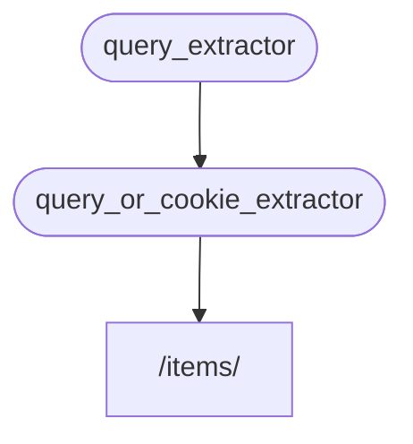

# Подзависимости

> Перевод страницы [Sub-dependencies](https://fastapi.tiangolo.com/tutorial/dependencies/sub-dependencies/) документации FastAPI.
> Оригинал: © Sebastián Ramírez, лицензия MIT.

Можно создавать зависимости, у которых есть **подзависимости**.

Они могут быть настолько **глубокими**, насколько нужно.

**FastAPI** позаботится об их разрешении.

## Первая зависимость («dependable»)

Можно создать первую зависимость («dependable») так:

```python title="dependencies/tutorial005_an_py310.py"
from typing import Annotated

from fastapi import Cookie, Depends, FastAPI

app = FastAPI()


def query_extractor(q: str | None = None):
    return q


def query_or_cookie_extractor(
    q: Annotated[str, Depends(query_extractor)],
    last_query: Annotated[str | None, Cookie()] = None,
):
    if not q:
        return last_query
    return q


@app.get("/items/")
async def read_query(
    query_or_default: Annotated[str, Depends(query_or_cookie_extractor)],
):
    return {"q_or_cookie": query_or_default}
```

Она объявляет необязательный параметр запроса `q` типа `str`, а затем просто возвращает его.

Это довольно просто (и не очень полезно), но поможет сосредоточиться на том, как работают подзависимости.

## Вторая зависимость — «dependable» и «dependant» одновременно

Затем можно создать ещё одну функцию-зависимость («dependable»), которая при этом объявляет собственную зависимость (то есть тоже является «dependant» — зависимой) — это `query_or_cookie_extractor` в примере выше.

Посмотрим на объявленные параметры:

* Хотя эта функция сама является зависимостью («dependable»), она также объявляет другую зависимость (она «зависит» от чего-то ещё).
    * Она зависит от `query_extractor` и присваивает возвращённое им значение параметру `q`.
* Она также объявляет необязательную cookie `last_query` типа `str`.
    * Если пользователь не передал запрос `q`, мы используем последний использованный запрос, который ранее сохранили в cookie.

## Используйте зависимость

Затем зависимость можно использовать так (см. `read_query` в примере выше).

> **Примечание**
>
> Обратите внимание, что в *функции операции пути* мы объявляем только одну зависимость — `query_or_cookie_extractor`.
>
> Но **FastAPI** будет знать, что сначала нужно разрешить `query_extractor`, чтобы передать его результат в `query_or_cookie_extractor` при её вызове.



## Многократное использование одной зависимости

Если одна из ваших зависимостей объявлена несколько раз для одной и той же *операции пути* — например, у нескольких зависимостей есть общая подзависимость, — **FastAPI** будет знать, что вызвать эту подзависимость нужно только один раз за запрос.

И он сохранит возвращённое значение в <dfn title="Утилита/система для хранения вычисленных/сгенерированных значений, чтобы переиспользовать их, а не вычислять заново.">«кэше»</dfn> и передаст его всем «зависимым», которым оно нужно в этом конкретном запросе, вместо того чтобы вызывать зависимость несколько раз для одного запроса.

В продвинутом сценарии, когда вы знаете, что зависимость нужно вызывать на каждом шаге (возможно, несколько раз) в одном запросе вместо использования «закэшированного» значения, можно задать параметр `use_cache=False` при использовании `Depends`:

**Python 3.10+**

```Python
async def needy_dependency(
    fresh_value: Annotated[str, Depends(get_value, use_cache=False)],
):
    return {"fresh_value": fresh_value}
```

**Python 3.10+ без Annotated** (по возможности предпочитайте версию с `Annotated`)

```Python
async def needy_dependency(fresh_value: str = Depends(get_value, use_cache=False)):
    return {"fresh_value": fresh_value}
```

## Итоги

Если отбросить все громкие слова, система **внедрения зависимостей** довольно проста.

Это просто функции, которые выглядят так же, как *функции операций пути*.

Но при этом она очень мощная и позволяет объявлять «графы» (деревья) зависимостей произвольной глубины.

> **Совет**
>
> На этих простых примерах всё это может показаться не таким уж полезным.
>
> Но вы увидите, насколько это полезно, в главах о **безопасности**.
>
> И увидите, сколько кода это вам сэкономит.
