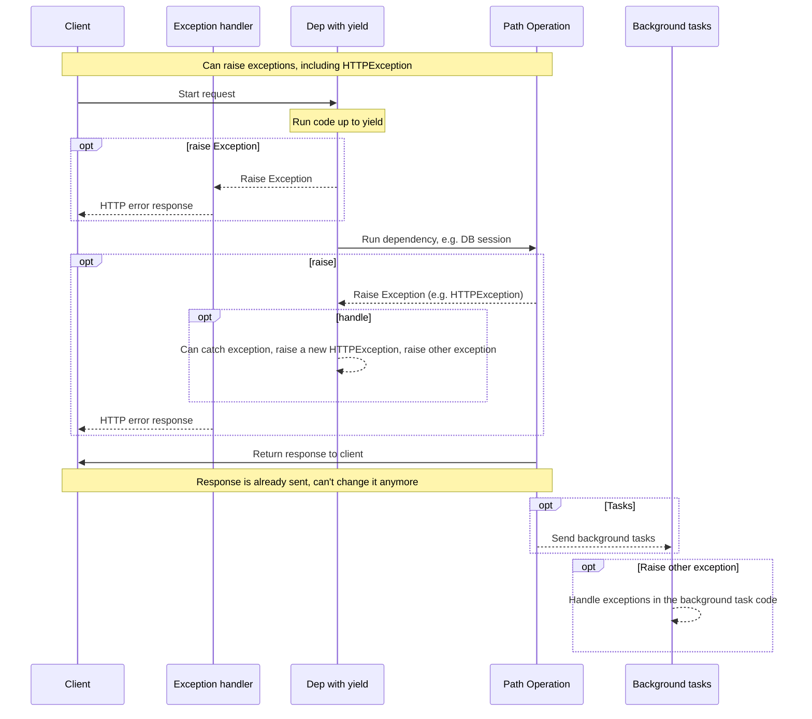
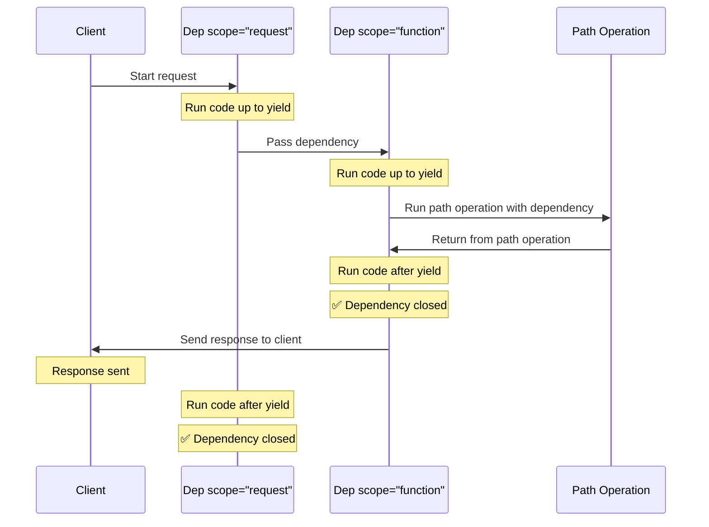

# Зависимости с yield

> Перевод страницы [Dependencies with yield](https://fastapi.tiangolo.com/tutorial/dependencies/dependencies-with-yield/) документации FastAPI.
> Оригинал: © Sebastián Ramírez, лицензия MIT.

FastAPI поддерживает зависимости, которые выполняют <dfn title='иногда это также называют «кодом выхода», «кодом очистки», «кодом завершения», «кодом закрытия», «кодом выхода из контекстного менеджера» и т. д.'>дополнительные шаги после завершения</dfn>.

Для этого используйте `yield` вместо `return`, а дополнительные шаги (код) пишите после него.

> **Совет**
>
> Используйте `yield` в каждой зависимости только один раз.

> **Примечание | Технические подробности**
>
> Любая функция, которую можно использовать с:
>
> * [`@contextlib.contextmanager`](https://docs.python.org/3/library/contextlib.html#contextlib.contextmanager) или
> * [`@contextlib.asynccontextmanager`](https://docs.python.org/3/library/contextlib.html#contextlib.asynccontextmanager)
>
> можно использовать и как зависимость **FastAPI**.
>
> На самом деле FastAPI внутри использует именно эти два декоратора.

## Зависимость базы данных с `yield`

Например, так можно создать сессию базы данных и закрыть её по окончании.

До создания ответа выполняется только код до инструкции `yield` включительно:

```python title="dependencies/tutorial007_py310.py"
async def get_db():
    db = DBSession()
    try:
        yield db
    finally:
        db.close()
```

Значение, переданное через `yield` (здесь `db`), — это то, что внедряется в *операции пути* и другие зависимости.

Код после инструкции `yield` выполняется после ответа (здесь — `db.close()`).

> **Совет**
>
> Можно использовать `async`- или обычные функции.
>
> **FastAPI** правильно обработает каждую из них, так же как обычные зависимости.

## Зависимость с `yield` и `try`

Если в зависимости с `yield` используется блок `try`, вы получите любое исключение, которое было возбуждено при использовании зависимости.

Например, если какой-то код где-то посередине — в другой зависимости или в *операции пути* — выполнил «откат» (rollback) транзакции базы данных или вызвал любое другое исключение, вы получите это исключение в своей зависимости.

Поэтому внутри зависимости можно отлавливать конкретное исключение с помощью `except SomeException`.

Точно так же можно использовать `finally`, чтобы гарантировать выполнение шагов выхода, независимо от того, было исключение или нет (см. пример `get_db` выше).

## Подзависимости с `yield`

Можно иметь подзависимости и «деревья» подзависимостей любого размера и формы, и любые из них (или все) могут использовать `yield`.

**FastAPI** позаботится о том, чтобы «код выхода» каждой зависимости с `yield` выполнялся в правильном порядке.

Например, `dependency_c` может зависеть от `dependency_b`, а `dependency_b` — от `dependency_a`:

```python title="dependencies/tutorial008_an_py310.py"
from typing import Annotated

from fastapi import Depends


async def dependency_a():
    dep_a = generate_dep_a()
    try:
        yield dep_a
    finally:
        dep_a.close()


async def dependency_b(dep_a: Annotated[DepA, Depends(dependency_a)]):
    dep_b = generate_dep_b()
    try:
        yield dep_b
    finally:
        dep_b.close(dep_a)


async def dependency_c(dep_b: Annotated[DepB, Depends(dependency_b)]):
    dep_c = generate_dep_c()
    try:
        yield dep_c
    finally:
        dep_c.close(dep_b)
```

И все они могут использовать `yield`.

В этом случае `dependency_c`, чтобы выполнить свой код выхода, нужно, чтобы значение из `dependency_b` (здесь — `dep_b`) всё ещё было доступно.

А `dependency_b`, в свою очередь, нужно, чтобы для её кода выхода было доступно значение из `dependency_a` (здесь — `dep_a`).

Точно так же можно иметь одни зависимости с `yield`, а другие — с `return`, и одни из них могут зависеть от других.

И можно иметь одну зависимость, которой нужны несколько других зависимостей с `yield`, и т. д.

Можно иметь любые нужные вам комбинации зависимостей.

**FastAPI** позаботится о том, чтобы всё выполнялось в правильном порядке.

> **Примечание | Технические подробности**
>
> Это работает благодаря [контекстным менеджерам](https://docs.python.org/3/library/contextlib.html) Python.
>
> **FastAPI** использует их внутри, чтобы этого добиться.

## Зависимости с `yield` и `HTTPException`

Вы видели, что можно использовать зависимости с `yield` и блоки `try`, которые пытаются выполнить какой-то код, а затем выполняют код выхода в `finally`.

Можно также использовать `except`, чтобы перехватить возбуждённое исключение и что-то с ним сделать.

Например, можно возбудить другое исключение, например `HTTPException`.

> **Совет**
>
> Это несколько продвинутый приём, и в большинстве случаев он вам не понадобится, поскольку исключения (включая `HTTPException`) можно возбуждать из остального кода приложения, например из *функции операции пути*.
>
> Но он к вашим услугам, если понадобится. 🤓

```python title="dependencies/tutorial008b_an_py310.py"
from typing import Annotated

from fastapi import Depends, FastAPI, HTTPException

app = FastAPI()


data = {
    "plumbus": {"description": "Freshly pickled plumbus", "owner": "Morty"},
    "portal-gun": {"description": "Gun to create portals", "owner": "Rick"},
}


class OwnerError(Exception):
    pass


def get_username():
    try:
        yield "Rick"
    except OwnerError as e:
        raise HTTPException(status_code=400, detail=f"Owner error: {e}")


@app.get("/items/{item_id}")
def get_item(item_id: str, username: Annotated[str, Depends(get_username)]):
    if item_id not in data:
        raise HTTPException(status_code=404, detail="Item not found")
    item = data[item_id]
    if item["owner"] != username:
        raise OwnerError(username)
    return item
```

Если вы хотите перехватывать исключения и создавать на их основе собственный ответ, создайте [собственный обработчик исключений](25-handling-errors.md).

## Зависимости с `yield` и `except`

Если в зависимости с `yield` перехватить исключение с помощью `except` и не возбудить его снова (или не возбудить новое исключение), FastAPI не сможет заметить, что исключение было, — так же, как это было бы в обычном Python:

```python title="dependencies/tutorial008c_an_py310.py"
from typing import Annotated

from fastapi import Depends, FastAPI, HTTPException

app = FastAPI()


class InternalError(Exception):
    pass


def get_username():
    try:
        yield "Rick"
    except InternalError:
        print("Oops, we didn't raise again, Britney 😱")


@app.get("/items/{item_id}")
def get_item(item_id: str, username: Annotated[str, Depends(get_username)]):
    if item_id == "portal-gun":
        raise InternalError(
            f"The portal gun is too dangerous to be owned by {username}"
        )
    if item_id != "plumbus":
        raise HTTPException(
            status_code=404, detail="Item not found, there's only a plumbus here"
        )
    return item_id
```

В этом случае клиент, как и положено, увидит ответ *HTTP 500 Internal Server Error*, поскольку мы не возбуждаем `HTTPException` или что-то подобное, но на сервере **не будет никаких логов** или других указаний на то, какая была ошибка. 😱

### Всегда используйте `raise` в зависимостях с `yield` и `except`

Если вы перехватываете исключение в зависимости с `yield`, то, если только вы не возбуждаете другой `HTTPException` или что-то подобное, **следует повторно возбудить исходное исключение**.

Повторно возбудить то же исключение можно с помощью `raise`:

```python title="dependencies/tutorial008d_an_py310.py"
from typing import Annotated

from fastapi import Depends, FastAPI, HTTPException

app = FastAPI()


class InternalError(Exception):
    pass


def get_username():
    try:
        yield "Rick"
    except InternalError:
        print("We don't swallow the internal error here, we raise again 😎")
        raise


@app.get("/items/{item_id}")
def get_item(item_id: str, username: Annotated[str, Depends(get_username)]):
    if item_id == "portal-gun":
        raise InternalError(
            f"The portal gun is too dangerous to be owned by {username}"
        )
    if item_id != "plumbus":
        raise HTTPException(
            status_code=404, detail="Item not found, there's only a plumbus here"
        )
    return item_id
```

Теперь клиент получит тот же ответ *HTTP 500 Internal Server Error*, но на сервере в логах будет наше собственное `InternalError`. 😎

## Выполнение зависимостей с `yield`

Последовательность выполнения выглядит примерно как на этой диаграмме. Время идёт сверху вниз. Каждый столбец — одна из частей, которые взаимодействуют или выполняют код.



> **Примечание**
>
> Клиенту будет отправлен только **один ответ**. Это может быть один из ответов с ошибкой или ответ от *операции пути*.
>
> После того как один из этих ответов отправлен, никакой другой ответ отправить уже нельзя.

> **Совет**
>
> Если в коде *функции операции пути* возбудить любое исключение, оно будет передано в зависимости с yield, включая `HTTPException`. В большинстве случаев из зависимости с `yield` нужно повторно возбудить то же исключение или новое, чтобы оно было правильно обработано.

## Ранний выход и `scope`

Обычно код выхода зависимостей с `yield` выполняется **после отправки ответа** клиенту.

Но если вы знаете, что зависимость не понадобится после возврата из *функции операции пути*, можно использовать `Depends(scope="function")`, чтобы сообщить FastAPI, что зависимость нужно закрыть после возврата из *функции операции пути*, но **до** **отправки ответа**.

```python title="dependencies/tutorial008e_an_py310.py"
from typing import Annotated

from fastapi import Depends, FastAPI

app = FastAPI()


def get_username():
    try:
        yield "Rick"
    finally:
        print("Cleanup up before response is sent")


@app.get("/users/me")
def get_user_me(username: Annotated[str, Depends(get_username, scope="function")]):
    return username
```

`Depends()` принимает параметр `scope`, который может быть:

* `"function"`: запустить зависимость до *функции операции пути*, обрабатывающей запрос, и завершить зависимость после окончания *функции операции пути*, но **до** отправки ответа клиенту. То есть функция-зависимость будет выполняться **вокруг** *функции операции пути*.
* `"request"`: запустить зависимость до *функции операции пути*, обрабатывающей запрос (как и в случае `"function"`), но завершить **после** отправки ответа клиенту. То есть функция-зависимость будет выполняться **вокруг** цикла **запрос–ответ**.

Если не указано и у зависимости есть `yield`, по умолчанию у неё будет `scope` равный `"request"`.

### `scope` для подзависимостей

Если вы объявляете зависимость со `scope="request"` (по умолчанию), то у любой подзависимости тоже должен быть `scope` равный `"request"`.

А зависимость со `scope` равным `"function"` может иметь зависимости как со `scope` `"function"`, так и со `scope` `"request"`.

Дело в том, что любая зависимость должна иметь возможность выполнить свой код выхода раньше подзависимостей, поскольку она может ещё использовать их в своём коде выхода.



## Зависимости с `yield`, `HTTPException`, `except` и фоновые задачи

Зависимости с `yield` со временем развивались, чтобы охватывать разные сценарии использования и исправлять некоторые проблемы.

Если хотите узнать, что менялось в разных версиях FastAPI, подробнее об этом можно прочитать в продвинутом руководстве: [Продвинутые зависимости — зависимости с `yield`, `HTTPException`, `except` и фоновые задачи](https://fastapi.tiangolo.com/advanced/advanced-dependencies/#dependencies-with-yield-httpexception-except-and-background-tasks).

## Контекстные менеджеры

### Что такое «контекстные менеджеры»

«Контекстные менеджеры» — это любые объекты Python, которые можно использовать в инструкции `with`.

Например, [`with` можно использовать для чтения файла](https://docs.python.org/3/tutorial/inputoutput.html#reading-and-writing-files):

```Python
with open("./somefile.txt") as f:
    contents = f.read()
    print(contents)
```

«Под капотом» `open("./somefile.txt")` создаёт объект, который называется «контекстным менеджером».

Когда блок `with` завершается, он гарантирует закрытие файла, даже если были исключения.

Когда вы создаёте зависимость с `yield`, **FastAPI** внутри создаёт для неё контекстный менеджер и объединяет его с некоторыми другими связанными инструментами.

### Использование контекстных менеджеров в зависимостях с `yield`

> **Внимание**
>
> Это, в общем-то, «продвинутая» идея.
>
> Если вы только начинаете работать с **FastAPI**, пока можно её пропустить.

В Python контекстные менеджеры можно создавать, [создав класс с двумя методами: `__enter__()` и `__exit__()`](https://docs.python.org/3/reference/datamodel.html#context-managers).

Их также можно использовать внутри зависимостей **FastAPI** с `yield`, применяя инструкции `with` или `async with` внутри функции-зависимости:

```python title="dependencies/tutorial010_py310.py"
class MySuperContextManager:
    def __init__(self):
        self.db = DBSession()

    def __enter__(self):
        return self.db

    def __exit__(self, exc_type, exc_value, traceback):
        self.db.close()


async def get_db():
    with MySuperContextManager() as db:
        yield db
```

> **Совет**
>
> Другой способ создать контекстный менеджер — с помощью:
>
> * [`@contextlib.contextmanager`](https://docs.python.org/3/library/contextlib.html#contextlib.contextmanager) или
> * [`@contextlib.asynccontextmanager`](https://docs.python.org/3/library/contextlib.html#contextlib.asynccontextmanager)
>
> задекорировав ими функцию с единственным `yield`.
>
> Именно это **FastAPI** использует внутри для зависимостей с `yield`.
>
> Но для зависимостей FastAPI использовать эти декораторы не нужно (и не следует).
>
> FastAPI сделает это за вас внутри.
