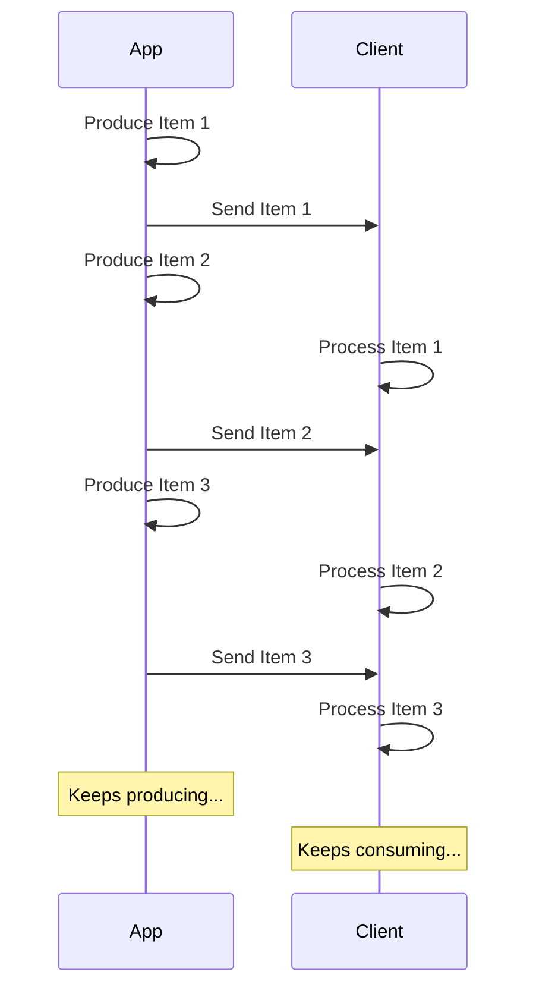

# Потоковая передача JSON Lines

> Перевод страницы [Stream JSON Lines](https://fastapi.tiangolo.com/tutorial/stream-json-lines/) документации FastAPI.
> Оригинал: © Sebastián Ramírez, лицензия MIT.

Если у вас есть последовательность данных, которую нужно отправлять «**потоком**» (stream), это можно сделать с помощью **JSON Lines**.

> **Примечание**
>
> Добавлено в FastAPI 0.134.0.

## Что такое поток

«**Потоковая передача**» (streaming) данных означает, что приложение начнёт отправлять элементы данных клиенту, не дожидаясь, пока будет готова вся последовательность.

То есть оно отправит первый элемент, клиент получит его и начнёт обрабатывать, а вы в это время, возможно, ещё будете формировать следующий.



Это может быть даже бесконечный поток, в котором вы продолжаете отправлять данные.

## JSON Lines

В таких случаях обычно отправляют «**JSON Lines**» — формат, в котором на каждой строке передаётся один JSON-объект.

Тип содержимого ответа будет `application/jsonl` (вместо `application/json`), а тело будет примерно таким:

```json
{"name": "Plumbus", "description": "A multi-purpose household device."}
{"name": "Portal Gun", "description": "A portal opening device."}
{"name": "Meeseeks Box", "description": "A box that summons a Meeseeks."}
```

Это очень похоже на JSON-массив (аналог списка в Python), но вместо того, чтобы быть обёрнутым в `[]` с `,` между элементами, здесь **по одному JSON-объекту на строку**, разделённых символом новой строки.

> **Примечание**
>
> Важно то, что приложение сможет формировать каждую строку по очереди, пока клиент обрабатывает предыдущие.

> **Примечание | Технические подробности**
>
> Поскольку JSON-объекты разделяются символом новой строки, в их содержимом не может быть буквальных символов новой строки, но могут быть экранированные (`\n`), что является частью стандарта JSON.
>
> Но обычно об этом беспокоиться не нужно — это делается автоматически, читайте дальше. 🤓

## Сценарии использования

Это можно использовать для потоковой передачи данных из сервиса **ИИ (LLM)**, из **логов** или **телеметрии**, либо других видов данных, которые можно структурировать в виде **JSON**-элементов.

> **Совет**
>
> Если нужно передавать потоком бинарные данные, например видео или аудио, загляните в продвинутое руководство: [Потоковая передача данных](https://fastapi.tiangolo.com/advanced/stream-data/).

## Потоковая передача JSON Lines в FastAPI

Чтобы передавать JSON Lines потоком в FastAPI, вместо `return` в *функции операции пути* можно использовать `yield`, выдавая элементы по очереди.

```python title="stream_json_lines/tutorial001_py310.py"
from collections.abc import AsyncIterable, Iterable

from fastapi import FastAPI
from pydantic import BaseModel

app = FastAPI()


class Item(BaseModel):
    name: str
    description: str | None


items = [
    Item(name="Plumbus", description="A multi-purpose household device."),
    Item(name="Portal Gun", description="A portal opening device."),
    Item(name="Meeseeks Box", description="A box that summons a Meeseeks."),
]


@app.get("/items/stream")
async def stream_items() -> AsyncIterable[Item]:
    for item in items:
        yield item
```

Если каждый отправляемый JSON-элемент имеет тип `Item` (модель Pydantic) и функция асинхронная, тип возвращаемого значения можно объявить как `AsyncIterable[Item]` (как в примере выше).

Если объявить тип возвращаемого значения, FastAPI будет использовать его, чтобы **валидировать** данные, **документировать** их в OpenAPI, **фильтровать** и **сериализовать** с помощью Pydantic.

> **Совет**
>
> Поскольку Pydantic будет сериализовать данные на стороне **Rust**, **производительность** будет гораздо выше, чем без объявления типа возвращаемого значения.

### Не-async *функции операций пути*

Можно также использовать обычные функции `def` (без `async`) и точно так же применять `yield`.

FastAPI позаботится о том, чтобы они выполнялись правильно и не блокировали цикл событий.

Поскольку в этом случае функция не асинхронная, правильным типом возвращаемого значения будет `Iterable[Item]`:

```python title="stream_json_lines/tutorial001_py310.py"
@app.get("/items/stream-no-async")
def stream_items_no_async() -> Iterable[Item]:
    for item in items:
        yield item
```

### Без типа возвращаемого значения

Тип возвращаемого значения можно и не указывать. Тогда FastAPI использует [`jsonable_encoder`](27-encoder.md), чтобы преобразовать данные во что-то, что можно сериализовать в JSON, и отправит их как JSON Lines.

```python title="stream_json_lines/tutorial001_py310.py"
@app.get("/items/stream-no-annotation")
async def stream_items_no_annotation():
    for item in items:
        yield item
```

## Server-Sent Events (SSE)

В FastAPI также есть полноценная поддержка Server-Sent Events (SSE) — они очень похожи, но с парой дополнительных деталей. О них можно узнать в следующей главе: [Server-Sent Events (SSE)](45-server-sent-events.md). 🤓
